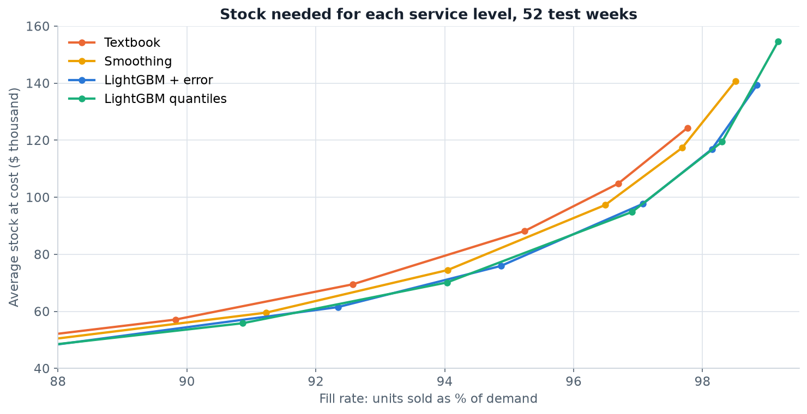
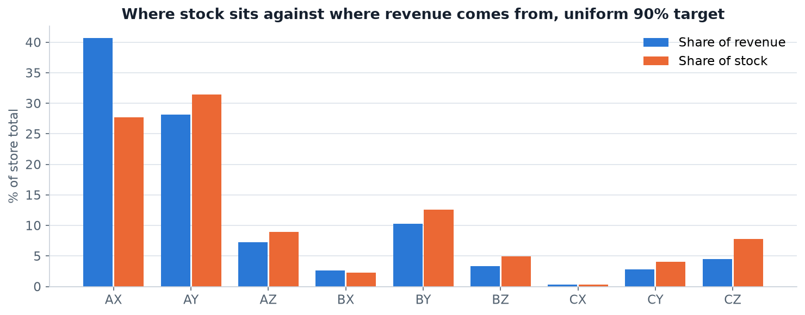
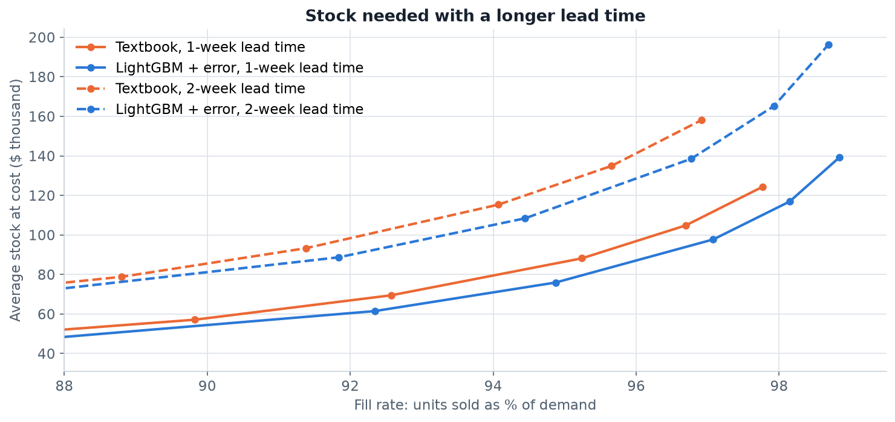
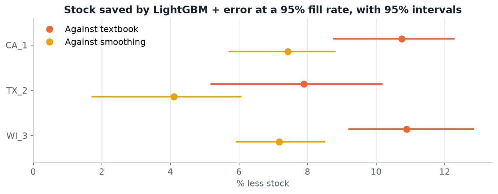

# How Much Is a Better Forecast Worth?

[](https://github.com/Haven-Pham/demand-forecasting-inventory-optimization/actions/workflows/ci.yml)


## Overview

Forecasting projects usually stop at an accuracy table, but a store manager needs something else: how much stock to hold, and how many sales
will still be lost. This project takes forecasts through to that decision. It compares simple planning methods with a LightGBM model on
3,049 products at a Walmart store, then simulates a year of weekly replenishment under each one to measure stock and lost sales.

**Summary of results.** LightGBM needs 10.7% less stock than a textbook safety stock policy at a 95% fill rate (95% interval 8.8–12.3%), and
8–11% across three stores. Under the assumed costs, the larger prize is sales: holding the stock level and losing fewer sales is worth about six
times the holding cost saved. Two common assumptions did not hold up: quantile models did not beat simple safety stock, and ABC service tiers
needed more stock than one uniform target. A second week of lead time adds 47–50% more stock at the same fill rate, over four times what the better
forecast saves.



## Business Questions

1. How much more accurate is a machine learning model than the methods planners already use, and where?
2. Can its uncertainty estimates be trusted?
3. How much stock or lost sales does a better forecast change?
4. Should service targets differ by ABC class?
5. What does one more week of lead time cost?

## Approach

- **Forecast what the order must cover.** With a one-week lead time and weekly review, each order protects two weeks, so every method forecasts
  two-week demand.
- **Rolling-origin backtest.** Forecasts for the last 52 weeks use only what was known at the time. LightGBM is refitted every 13 weeks on targets
  already resolved, and a test confirms that changing future sales cannot change the features. Settings were chosen on earlier weeks.
- **Four replenishment policies.** Each sets a weekly order-up-to level for the same items in the same weeks:

  | Policy | Order-up-to level |
  |---|---|
  | Textbook | 8-week moving average, plus z × weekly demand deviation |
  | Smoothing | Exponential smoothing, plus z × the item's recent forecast error |
  | LightGBM + error | LightGBM mean, plus z × the item's recent forecast error |
  | LightGBM quantiles | A separate LightGBM model for each service target |

- **Simulation.** Each item is simulated week by week with lost sales. Policies are compared along their full trade-off curves, so a policy cannot look
  better merely by being more aggressive. Differences carry 95% bootstrap intervals from resampling items.
- **Honest about missing data.** M5 has no stock records and no costs. Zero-sales weeks that look like stockouts are flagged and tested separately, and
  cost assumptions (30% margin, 25% annual holding rate) are varied.

## Key Findings

**LightGBM is the most accurate, by a modest margin.** Item-level demand is noisy, and no model removes that. Its lead is largest when a price is about to change
(WAPE 36.3% against 45.0% for smoothing after a planned cut of 5% or more), though such cases are only about 1.5% of demand.

| Method | Two-week WAPE | Bias |
|---|---:|---:|
| LightGBM | 30.6% | +3.6% |
| Exponential smoothing | 32.0% | −0.4% |
| Moving average (8 weeks) | 33.7% | −0.4% |
| Croston (SBA) | 40.1% | −1.5% |
| Seasonal naive | 56.4% | +0.4% |

**A service target is not a fill rate.** A 90% target means a 90% chance of no stockout in a cycle, and it delivered a 95–97% fill rate here. A team that treats the two as
equal will overstock.

**Better forecasts reduce stock, and part of the gain needs no machine learning.**

| Stock needed at a 95% fill rate | Average stock at cost | Saving against textbook |
|---|---:|---:|
| Textbook | $86,488 | – |
| Smoothing + forecast error | $83,382 | 3.6% |
| LightGBM + forecast error | $77,193 | 10.7% |
| LightGBM quantiles | $78,429 | 9.3% |

**The money is in sales, not stock.** Starting from the textbook policy at a 95.2% fill rate, the forecast improvement can be spent in two ways:

| Route | Change | Annual value at this store |
|---|---:|---:|
| Keep service, hold less stock | $8,601 less stock (9.8%) | about $2,150 |
| Keep stock, lose fewer sales | 0.87 points more fill | about $13,500 |

Both values depend on the assumed costs, so the ratio matters more than the amounts.

**Calibrated is not the same as useful.** The quantile models are well calibrated: the 90% quantile covered 90.0% of demand. Yet they need 2–3% more stock than simple
error-based safety stock at a 95% fill rate in all three stores, and they take six models instead of one.

**ABC tiers needed more stock than one uniform target.** All four plans tested needed 2–11% more stock for the same revenue fill. Class C holds only 12% of stock, so lowering its target saves
little, while pushing class A higher is expensive. This fits newsvendor theory, in which the target depends on margin and holding cost rather than sales volume. Only four hand-set plans were tested, and margins
were assumed proportional for all items.



**Lead time outweighs the forecast upgrade.** At a 95% fill rate, a second week of lead time raises stock by 47% under the textbook policy and 50% under LightGBM. For the textbook policy that is about $40,000 of stock, over four times the
$9,300 saved by the better forecast.



**The conclusions hold under checks.** The savings repeat in two other stores (TX_2 and WI_3). Filling suspected stockout weeks with the prior rate adds 3.2% to demand and
barely moves the saving (10.7% to 10.9%). LightGBM has the lower simulated cost at all nine combinations of margin and holding rate tested, by 7–30%.



## Recommendations

| Finding | Decision it informs |
|---|---|
| A service target is not a fill rate | Set targets by reading the achieved fill rate from a simulation |
| LightGBM cuts stock by 8–11% at the same fill rate | A global model is worth testing, and should be judged in stock and sales rather than WAPE alone |
| Most of the money is in recovered sales | Keep stock level and lose fewer sales, unless space or cash is the binding constraint |
| Quantile models are calibrated but not better for stock | Start with one model and error-based safety stock, which is simpler to run and explain |
| ABC tiers needed more stock than a uniform target | Set tiers from margin and constraints, not from revenue class alone |
| A week of lead time costs over four times the forecast saving | Before buying better forecasts, check whether a shorter or more reliable lead time is available |

## Deliverables

- [Analysis notebook](notebooks/demand_forecasting_inventory_optimization.ipynb): the full analysis with its reasoning and limitations.
- [Excel workbook](reports/Demand_Forecast_Inventory_Results.xlsx): a summary sheet and 15 result tables.
- [Figures](reports/figures) and [CSV tables](reports/tables).
- A tested Python package in [src/demand_inventory](src/demand_inventory): features, forecasts, simulation and policy comparison.

## Repository Structure

```
├── data/README.md        Data source and why the raw files are not committed
├── notebooks/            Analysis notebook, with outputs
├── reports/              Excel workbook, figures and aggregated tables
├── scripts/              Download, backtest, run notebook, build workbook
├── src/demand_inventory/ Data, forecast, inventory, policies and metrics modules
├── tests/                Unit tests, including leakage and stock conservation checks
└── .github/workflows/    Tests on every push, and a full reproduction on request
```

## Reproducing

```bash
pip install -r requirements.txt
python -m pytest -q
python scripts/download_data.py
python scripts/run_backtest.py CA_1 TX_2 WI_3      # about 50 minutes on 8 cores
python scripts/run_backtest.py CA_1 --horizon=3    # two-week lead time
python scripts/run_notebook.py
python scripts/build_excel_report.py
```

Model seeds are fixed, but gradient boosting results can differ slightly across machines and library builds, so a rerun may not match every decimal.

## Data

[M5 Forecasting Accuracy dataset](https://zenodo.org/records/12636070): daily Walmart sales and weekly prices, 2011–2016. The raw files and item-level forecasts are not committed, because I could
not confirm the original redistribution terms. See [data/README.md](data/README.md) for the source and citation.

## Limitations

- **Sales are not demand.** There are no stock records, so hidden stockouts remain in the data, and the correction tested here is rough.
- **Costs are assumed.** Margin, holding rate and proportional margins are assumptions, so comparisons are more reliable than dollar amounts.
- **Simplified operations.** The simulation has weekly buckets, a fixed lead time, no pack sizes or minimum orders, no shelf limits, no substitution between items and no waste, which matters for food.
- **Stock is measured at week end.** Absolute levels exclude goods in transit and are lower than a real store's total stock.
- **No feedback.** Real ordering decisions shape the sales that later train the model, and a backtest cannot capture that.
- **Limited scope.** Three stores over one test year ending in May 2016. The lead-time test covers one store.
- **Price plans are treated as known,** using prices actually charged.

## Author

Pham Hong Hieu (Haven) · [Portfolio](https://haven-portfolio02.vercel.app) · [LinkedIn](https://www.linkedin.com/in/havenpham) · [GitHub](https://github.com/Haven-Pham)
